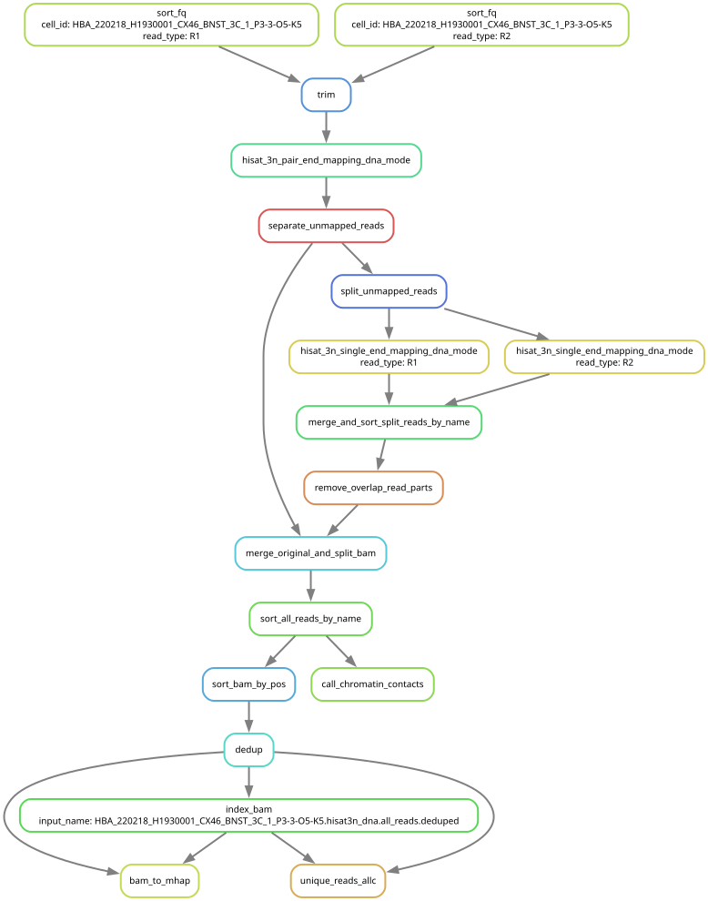

# Installation
## Create environment and install
```shell
conda install -y -n base -c conda-forge mamba
conda config --add channels defaults
conda config --add channels bioconda
conda config --add channels conda-forge

mamba env create -f https://raw.githubusercontent.com/DingWB/cemba_data/master/yap.yaml

# if failed, try:
# mamba env create -f https://raw.githubusercontent.com/DingWB/cemba_data/master/env_greedy.yaml
conda activate yap

# conda env export > env_greedy.yaml
```
## To install this latest version:
```shell
pip install git+https://github.com/DingWB/cemba_data

# reinstall
pip uninstall -y cemba_data && pip install git+https://github.com/DingWB/cemba_data

```

# Documentation
## Make sure create the right environment

## Generate config.ini
```shell
# m3c
yap default-mapping-config --mode m3c --barcode_version V2 --bismark_ref "~/Ref/mm10/mm10_ucsc_with_chrL.bismark1" --genome "~/Ref/mm10/mm10_ucsc_with_chrL.fa" --chrom_size_path "~/Ref/mm10/mm10_ucsc.nochrM.sizes" --hisat3n_dna_ref  "~/Ref/mm10/mm10_ucsc_with_chrL" > m3c_config.ini

#mC
yap default-mapping-config --mode mc --barcode_version V2 --bismark_ref "~/Ref/mm10/mm10_ucsc_with_chrL.bismark1" --genome "~/Ref/mm10/mm10_ucsc_with_chrL.fa" --chrom_size_path "~/Ref/mm10/mm10_ucsc.nochrM.sizes" --hisat3n_dna_ref  "~/Ref/mm10/mm10_ucsc_with_chrL" > mc_config.ini
# pay attention to the path of reference, should be the same as on the GCP if you are going to run the pipeline on GCP.    

# mct
# bismark & STAR for mct (bowtie2)
yap default-mapping-config --mode mct --barcode_version V2 --bismark_ref "~/Ref/mm10/mm10_ucsc_with_chrL.bismark2" --genome "~/Ref/mm10/mm10_ucsc_with_chrL.fa" --chrom_size_path "~/Ref/mm10/mm10_ucsc.nochrM.sizes" --gtf "~/Ref/mm10/annotations/gencode.vM23.annotation.gtf" --star_ref "~/Ref/mm10/star_ref" > mct_config.ini

# hisat-3n for mct    
yap default-mapping-config --mode mct --barcode_version V2 --hisat3n_dna_ref "~/Ref/mm10/mm10_ucsc_with_chrL" --hisat3n_rna_ref "~/Ref/mm10/mm10_ucsc_with_chrL" --genome "~/Ref/mm10/mm10_ucsc_with_chrL.fa" --chrom_size_path "~/Ref/mm10/mm10_ucsc.nochrM.sizes" --gtf "~/Ref/mm10/annotations/gencode.vM23.annotation.gtf" > mct_config.ini
```

## Choose the methylation output: allc / cz
The `m3c` and `mc` pipelines (both the `bismark` and `hisat-3n` aligners) can
generate three kinds of per-cell methylation output. Which ones are produced is
controlled by three parameters in the `[output]` section of the mapping config
(`.ini`) file:

| parameter | values | meaning |
| --- | --- | --- |
| `mc_format` | `allc` / `cz` (**default**) / `both` | `cz` → `cz/<cell>.cz` (cytozip `bam_to_cz`, **default**); `allc` → `allc/<cell>.allc.tsv.gz` (ALLCools `bam-to-allc`); `both` → generate both |
| `reference_cz` | path to a `.cz` file | **required** when `mc_format` is `cz` or `both` |
| `extract_mcg` | `False` (**default**) / `True` | generate the CGN-merged ALLC `allc-CGN/<cell>.CGN-Merge.allc.tsv.gz`. **Off by default**; only meaningful when allc output is produced |

### 1. Generate .cz (cytozip) — default
`cz` is the **default** output. It needs a **reference `.cz`** built once per
genome with cytozip's `build_ref` (from the genome fasta + chrom_size):
```shell
# build the reference .cz once (reuse it for every mapping run)
czip build_ref -g ~/Ref/hg38/hg38_ucsc_with_chrL.fa \
  -O ~/Ref/hg38/hg38_ucsc_with_chrL.allc.cz \
  -s ~/Ref/hg38/hg38_ucsc.main.chrom.sizes -j 20
```
Then set in the config:
```ini
[output]
mc_format = cz            ; default; use "both" to also keep allc
reference_cz = ~/Ref/hg38/hg38_ucsc_with_chrL.allc.cz
```
If `reference_cz` is missing or not set while `mc_format` is `cz`/`both`, the
pipeline prints a warning with the exact `czip build_ref` command to run.

### 2. Generate ALLC instead of / in addition to .cz
```ini
[output]
mc_format = allc          ; or "both" to also generate cz
```

### 3. Generate the CGN-merged ALLC (allc-CGN)
`allc-CGN/<cell>.CGN-Merge.allc.tsv.gz` is **no longer produced by default**.
Enable it explicitly (only meaningful when allc output is generated):
```ini
[output]
mc_format = allc          ; or both
extract_mcg = True
```

### Generating the config with these options in one line
`yap default-mapping-config` forwards any extra `--key value` pairs into the
config, so you can set the output options directly:
```shell
# cz (default) — remember to build the reference .cz first (see above)
yap default-mapping-config --mode m3c --barcode_version V2 \
  --hisat3n_dna_ref "~/Ref/hg38/hg38_ucsc_with_chrL" \
  --genome "~/Ref/hg38/hg38_ucsc_with_chrL.fa" \
  --chrom_size_path "~/Ref/hg38/hg38_ucsc.main.chrom.sizes" \
  --reference_cz "~/Ref/hg38/hg38_ucsc_with_chrL.allc.cz" > m3c_config.ini

# allc + allc-CGN, hisat-3n
yap default-mapping-config --mode m3c --barcode_version V2 \
  --hisat3n_dna_ref "~/Ref/hg38/hg38_ucsc_with_chrL" \
  --genome "~/Ref/hg38/hg38_ucsc_with_chrL.fa" \
  --chrom_size_path "~/Ref/hg38/hg38_ucsc.main.chrom.sizes" \
  --mc_format allc --extract_mcg True > m3c_config.ini
```

## Demultiplex
```shell
# m3c
yap demultiplex --fastq_pattern "Pool_Remind1_m3c/*.fastq.gz" -o mapping/Pool_Remind1_m3c -j 16 --aligner hisat3n --config_path m3c_config.ini
# or
 yap-gcp run_demultiplex --fq_dir="Pool_Remind1_m3c" --outdir="mapping/Pool_Remind1_m3c" --gcp=False --n_jobs=16 --print_only=True 
 
# mc
 yap-gcp run_demultiplex --fq_dir="Pool_Remind1_mC" --outdir="mapping/Pool_Remind1_mC" --gcp=False --n_jobs=16 --print_only=True 
```

## Run mapping
```shell
sh mapping/snakemake/qsub/snakemake_cmd.txt # old yap pipeline
# or new yap-gcp pipeline
yap-gcp run_mapping --workd="mapping/Pool_Remind1_m3c" --gcp=False --config_path="m3c_config.ini" --aligner='hisat-3n' --n_jobs=64 --print_only=True
# or bismark
yap-gcp run_mapping --workd="mapping" --gcp=False --config_path="m3c_config.ini" --aligner='bismark' --n_jobs=64 --print_only=True
sh mapping/snakemake/qsub/snakemake_cmd.txt
```

### Start from cell-level BAM files (skip demultiplex and fastq -> bam)
`yap-gcp start_from_cell_bam` runs a snakemake template directly on existing cell BAM files, e.g. to generate mhap
files from the BAMs of a finished mapping run. It symlinks the BAMs matched by `--bam_pattern` into
`{output_dir}/Group{i}/bam/` (at most `--n_group` groups), copies the config to `{output_dir}/mapping_config.ini`
and writes one Snakefile per group; the cell ids are the part of the file names matched by `*`.

The default mapping templates end with the full mapping summary and need the fastq / bam stats of a complete
mapping run, so starting only from BAMs needs a BAM-only template such as
[bam2mhap.smk](cemba_data/files/smk/hisat3n/bam2mhap.smk) (hisat-3n BAMs -> `mhap/{cell_id}.CG.mhap.gz` and
`mhap/{cell_id}.CH.mhap.gz`). It accepts name-sorted `*.hisat3n_dna.all_reads.name_sort.bam` (sorted, deduplicated
and indexed first) or already deduplicated, position-sorted `*.hisat3n_dna.all_reads.deduped.bam`; the CpG / CH sites
are taken from `reference_fasta` (and the chromosomes from `chrom_size_path`) in the mapping config.
```shell
# mapping config: reference_fasta and chrom_size_path must be the genome the BAMs were aligned to
yap default-mapping-config --mode m3c --barcode_version V2 \
  --hisat3n_dna_ref "~/Ref/hg38/hg38_ucsc_with_chrL" \
  --genome "~/Ref/hg38/hg38_ucsc_with_chrL.fa" \
  --chrom_size_path "~/Ref/hg38/hg38_ucsc.main.chrom.sizes" > m3c_config.ini

SMK=$(python -c "import cemba_data,os; print(os.path.join(cemba_data.__path__[0],'files/smk/hisat3n/bam2mhap.smk'))")

# local / HPC: write mhap_run/snakemake/qsub/snakemake_cmd.txt (one snakemake command per group), then run it
# --indir: the directory containing the BAMs (e.g. one {workd}/{uid}/bam of a yap-gcp run, or a folder of symlinks)
yap-gcp start_from_cell_bam --indir="/path/to/bams" \
  --bam_pattern="*.hisat3n_dna.all_reads.name_sort.bam" \
  --output_dir="mhap_run" --gcp=False --config_path="m3c_config.ini" \
  --snakemake_template="${SMK}" --n_jobs=16 --n_group=64 --print_only=True
sh mhap_run/snakemake/qsub/snakemake_cmd.txt # or submit each line as a job
ls mhap_run/Group*/mhap/*.CG.mhap.gz

# GCP: output_dir is the GCS folder that already contains bam/{bam_pattern}; outputs are written there
yap-gcp start_from_cell_bam --output_dir="gs://bucket/mapping/uid" \
  --bam_pattern="*.hisat3n_dna.all_reads.name_sort.bam" --gcp=True --region='us-west1' \
  --config_path="m3c_config.ini" --snakemake_template="${SMK}" --n_jobs=64

# a single directory with bam/*.hisat3n_dna.all_reads.name_sort.bam can also be run without start_from_cell_bam
snakemake -d mapping/Pool_Remind1_m3c/<uid> -s ${SMK} -j 16 \
  --config reference_fasta="~/Ref/hg38/hg38_ucsc_with_chrL.fa" chrom_size_path="~/Ref/hg38/hg38_ucsc.main.chrom.sizes"
```
- `--bam_pattern`: BAM file name with one `*` (or `{cell_id}`) for the cell id.
- `--print_only=True` (local): only write the commands; with `--print_only=False` nothing is run locally.
- `--total_memory_gb`: memory per snakemake command (default `2 * n_jobs` GB).

## Workflow


### (5) yap vs yap-gcp: example on m3c
```shell
# generate config.ini; bismark
yap default-mapping-config --mode m3c --barcode_version V2 --bismark_ref "~/Ref/hg38/hg38_ucsc_with_chrL.bismark1" --genome " ~/Ref/hg38/hg38_ucsc_with_chrL.fa" --chrom_size_path " ~/Ref/hg38/hg38_ucsc.nochrM.sizes" > m3c_config.ini
# hisat3n
yap default-mapping-config --mode m3c --barcode_version V2 --hisat3n_dna_ref  "~/Ref/hg38/hg38_ucsc_with_chrL" --genome " ~/Ref/hg38/hg38_ucsc_with_chrL.fa" --chrom_size_path " ~/Ref/hg38/hg38_ucsc.nochrM.sizes" > m3c_hisat3n_config.ini

# (1). old yap pipeline
## demultiplex
yap demultiplex --fastq_pattern "/gale/raidix/rdx-2/illumina_runs/240322_M00412_0796_000000000-GK7K5_240325081847048305907-1/SALK054/*.fastq.gz" -o mapping -j 16 --aligner bismark --config_path m3c_config.ini #/usr/bin/time -f "%e\t%M\t%P" ;  2125.33 500364  195%
# elapsed real time (wall clock) in seconds; maximum resident set size in KB;  percent of CPU this job got
## mapping
sh mapping/snakemake/qsub/snakemake_cmd.txt
# /usr/bin/time -f "%e\t%M\t%P" UWA7648_CX2324_THM1_3_P12-2-N8 ; run one uid, 16 cpus; 4514.82 3393988 367%

# (2). new yap-gcp pipeline, run on local HPC (faster)
yap-gcp run_demultiplex --fq_dir=" /gale/raidix/rdx-2/illumina_runs/240322_M00412_0796_000000000-GK7K5_240325081847048305907-1/SALK054/" --outdir="mapping" --gcp=False --n_jobs=16
# time and memory usage: 69.52   282008  754%; 30X faster
yap-gcp run_mapping --workd="mapping" --gcp=False --config_path="m3c_config.ini" --aligner='bismark' --n_jobs=64 --print_only=True
sh mapping/snakemake/qsub/snakemake_cmd.txt
```